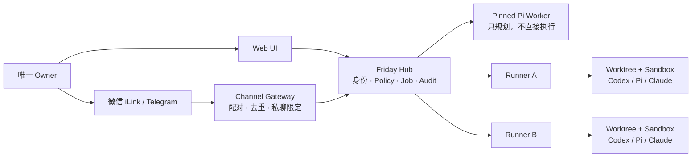

# Friday Agent

[English](README.en.md) | 中文

Friday Agent 是一个单用户、自托管的私人设备管家。你通过 Web、微信 iLink 或 Telegram 和它对话；Hub 负责身份、策略、审计和调度，轻量 Runner 在受控节点上执行任务。模型不会直接拿到 SSH、Root、Docker socket 或长期供应商密钥。

> 当前版本：`v0.2.1`。面向愿意自行部署和审查安全边界的早期用户。外部入口包含 Web UI、微信 iLink、Telegram，以及可选的飞书、企业微信智能机器人、QQ 官方机器人和中国移动新消息文字渠道。

## 它能做什么

- 通过浏览器原生 Basic Auth 进入 Web 控制台，对话并查看设备、任务、Diff、制品、长期记忆和待授权操作。
- 接收文字、图片和短视频；在受支持的浏览器中连续语音识别、朗读和开口打断。
- 在微信 iLink 扫码绑定后收发私聊；通过 Telegram Bot 接受唯一 Owner 的私聊。远端任务完成、失败或取消后，Gateway 会持久化重试并回推终态和有界结果摘要。
- 自动选择已登记、在线且能力匹配的节点：通用 Remote Agent 使用独立临时运行目录，Codex、Pi 或 Claude Code 使用独立 Git Worktree；两者都进入无网络 Sandbox。
- 通过 Hub 提供受限网络搜索；MCP、Skill 和 Procedure 默认关闭，启用前需要来源、版本、能力和回放证据。
- 允许 Friday 提出并自动启动隔离改进：低风险补丁在可信测试通过后自动采纳为下一次受控发布候选，只汇报 brief；联网/依赖、服务重启、Canary、Git Push、策略/凭据、Root、删除或生产切换仍需说明背景、风险和回滚方案，并申请 clearance。



## 设计边界

- **单 Owner**：这不是多租户 SaaS，也不是群聊机器人。
- **Hub 是控制根**：保存策略、审批、设备身份、会话和审计；始终只监听 `127.0.0.1:4310`。
- **Runner 只出站**：登记后主动访问 Hub，不开放 Friday 管理端口；SSH 只用于首次安装和升级。
- **执行强隔离**：Worktree 不是 Sandbox。真实工具必须经 root-owned `friday-sandboxd` 进入固定内容 ID 的容器。
- **通用 Agent 能力**：Remote Agent 自主规划并组合系统、进程、服务、日志、网络和受限文件工具；Hub 对每次调用单独分级与签名，不按具体诊断场景写分支。
- **凭据留在 Hub**：Runner 为当前签名 Job 换取短时模型令牌，节点不保存长期模型 Key。
- **默认拒绝**：配置不完整、设备离线、能力不匹配、租约过期、签名错误或 clearance 缺失时不执行。

## 推荐部署：Tailscale

推荐让 Hub 和所有受控节点加入同一个 Tailnet：Hub 继续监听 loopback，由 Tailscale Serve 提供 Tailnet 内 HTTPS；Runner 通过该 HTTPS 地址主动连接 Hub。不开 Funnel，也不需要开放 `4310`、Runner RPC 或 Sandbox 端口。

Hub 要求：Linux、Docker Engine、Docker Compose v2、OpenSSL、curl，以及已连接的 Tailscale。先确认你知道该节点的 Tailnet HTTPS Origin，然后执行：

```sh
git clone https://github.com/JimiZhou/friday-agent.git
cd friday-agent
sudo ./deploy/hub/install-hub.sh \
  --origin https://friday-hub.example-tailnet.ts.net \
  --network tailscale
```

安装器会：

1. 创建低权限 `friday-hub` 用户和私有状态目录；
2. 生成 Owner Token、Web Basic Auth 密码、Gateway control/ingest token；
3. 构建并启动 loopback Hub 与独立 Channel Gateway；
4. 配置 `tailscale serve`，但绝不启用 Funnel；
5. 输出 Web 地址和一次性展示的 Owner 凭据。

打开 Web 控制台时只需输入安装器输出的 Owner 用户名和 Basic Auth 密码；进入后可在“设备”页面直接生成微信 iLink 二维码并扫码确认。

### 配置 Telegram

先从 `@BotFather` 获取 Bot Token，并确认自己的数字 Telegram user ID。不要把 Token 写进 shell history；在当前 shell 中静默读取后调用配置脚本：

```sh
read -r -s FRIDAY_TELEGRAM_BOT_TOKEN
export FRIDAY_TELEGRAM_BOT_TOKEN
export FRIDAY_TELEGRAM_OWNER_ID='123456789'
sudo --preserve-env=FRIDAY_TELEGRAM_BOT_TOKEN,FRIDAY_TELEGRAM_OWNER_ID \
  ./deploy/hub/configure-telegram.sh
unset FRIDAY_TELEGRAM_BOT_TOKEN FRIDAY_TELEGRAM_OWNER_ID
```

Gateway 只接受这个 Owner 的私聊，拒绝群聊、其他 sender 和消息重放。

### 配置其他消息渠道

登录 Web 控制台的“设备”页面，在消息渠道配置区填写渠道凭据和 Owner sender ID。凭据写入 Gateway 私有状态目录，不会返回到浏览器或记录到 Hub 审计日志；已保存的凭据可留空复用。渠道只处理 Owner 私聊文字消息，不支持群聊和媒体消息。

- **飞书**：企业自建应用，开启机器人和 `im.message.receive_v1` 长连接事件；配置 App ID、App Secret，Owner ID 填 `open_id`。
- **企业微信**：使用支持 API 长连接的智能机器人，配置 Bot ID、Secret；Owner ID 填 `userid`，不需要公网回调。
- **QQ 官方机器人**：配置 App ID、App Secret，启用 `C2C_MESSAGE_CREATE`；Owner ID 填 `user_openid`。发送受 QQ 的主动消息额度和回复窗口约束。
- **中国移动新消息**：配置 Channel API Key；Owner ID 填平台消息的 `from` / `phone` 标识。Gateway 使用原生 WebSocket 协议适配，不安装面向 OpenClaw 的插件；需先确认 Owner 标识才会接收和回复。

保存后等待状态显示“已连接”，再从该渠道 Owner 私聊发送 `/menu`。停用渠道会清除 Gateway 凭据并撤销旧的 Hub 接入令牌。

### 通过 IM 管理 Runner

已配对的私聊渠道中，发送 `/`、`/menu` 或 `/help` 显示 Friday 平台操作菜单。菜单命令统一使用 `/` 前缀：

- `/status`：平台总览；`/devices`：设备列表；`/tasks`：最近任务；`/channels`：渠道状态。
- `/stop <jobId>`：发起停止任务；两分钟内回复 `/confirm stop <jobId>` 确认。
- `/cancel`：取消当前待确认操作；`/menu`：返回操作菜单。

也支持「查看设备」「查看任务」「新增纳管」等自然语言。复杂任务继续交给 Friday 的主对话 Agent；主 Agent 可通过 `platform_status` 和 `fleet_status` 读取全局状态，使用 `platform_menu` 返回实际可用命令。停止任务和撤销纳管的确认绑定当前渠道、私聊发送者和目标 ID；重复消息不重复执行。子节点主动连接 Hub 获取指令，无需 Hub 主动连接子节点。

设置 `FRIDAY_ISOLATED_JOB_AUTO_APPROVE=1` 后，Friday 会自动审核并启动 Owner 对话提出的隔离开发、审查和测试任务，无需逐项点击批准。Hub 仍检查节点在线、纳管状态、适配器和沙箱能力，记录策略审核事件，并保持无网络、无密钥的任务限制。当前 Runner 尚未实现的文件写入/删除、服务重启、进程信号和任意命令会直接返回不可用，让 Agent 重规划，不再产生无效审批。默认关闭；通用 Job API、生产变更和破坏性操作仍不获得自动授权。Friday 会先检查现状、优先执行可用步骤，仅在缺少必要信息或策略要求时请求确认。

Hub 默认关闭 IM 纳管命令。仅在受支持渠道已与 Owner 私聊配对后，才在 Hub 私有环境配置中启用 `FRIDAY_CHANNEL_FLEET_MANAGEMENT_ENABLE=1`。可用命令：

- `/runner help`：查看命令；`/runner list`：列出节点 ID、纳管状态、在线状态和未完成任务数。
- `/runner add [设备名] [服务用户] [SSH目标]`：直接返回一条粘贴到目标节点即可执行的纳管命令；命令含十分钟一次性凭据，只在当前私聊显示，不要转发或发到群聊。
- `/runner revoke <runnerId>`：发起撤销；必须在两分钟内原样回复 `/runner confirm revoke <runnerId>`。有未完成任务时拒绝撤销；待确认节点会暂时退出调度。
- `/runner cancel`：清除待确认撤销。

WebUI「新增纳管」默认一键生成完整命令：在子节点粘贴执行即可从 Hub 下载 Runner，校验固定 SHA-256，自动交接十分钟一次性凭据并启动常驻服务，无需项目源码或 Owner Token。节点需 Linux、Node.js 22.19+、curl、tar、sha256sum；有免密 sudo 时安装系统服务，否则安装启用 linger 的用户服务，或使用可访问 Docker 的用户启动自动重启容器（首次需能拉取 Node 镜像）。纳管及后续心跳、拉取任务、回传结果均由子节点主动访问 Hub HTTPS，Hub 无需反向访问子节点或知道 SSH 密码。Hub 镜像内置 Runner 分发包；非容器部署先执行 `node scripts/build-runner-distribution.mjs`。

Runner 启动时通过签名登记上报系统、CPU 型号/逻辑线程、物理内存及数据所在卷容量；`/devices`、`/runner list` 与 Web 设备管理以设备名称和表格展示，不显示内部 ID。缺少上报时显示「待上报」，不会推断硬盘健康。Docker 模式只读挂载宿主公开系统版本文件；没有宿主版本信息时明确标注运行环境系统。基础信息上报无需 root、工作区或沙箱；执行诊断任务仍需配置沙箱、注册受控工作区并在 Hub 启用适配器。撤销命令可使用唯一设备名称，重名时须在 Web 选择具体设备。

`/runner add` 不再返回 JSON 或要求下载 `fridayctl`。在 Hub 的 root-only `hub.env` 设置默认 SSH 目标后，例如 `FRIDAY_RUNNER_SSH_TARGET=hub-ssh`，私聊发送 `/runner add`，把回复代码块中的单行命令粘贴到目标节点终端即可。目标节点必须能以该 SSH 目标免密登录 Hub，并且 `known_hosts` 已信任 Hub 主机密钥；不需要 Tailscale、开放入站端口、项目源码或 Owner Token。命令会建立随系统启动、自动重连的 SSH 隧道，从 Hub 下载已构建的 Runner 包、校验 SHA-256、完成一次性登记并启动服务。也可发送 `/runner add build-node ubuntu hub-ssh` 显式指定设备名、服务用户和 SSH 目标。若需执行真实任务，仍须单独安装 Sandbox 并按现有审批规则授权。

## 快速纳管子节点

最简单的方式是直接使用上文的 `/runner add` 单行命令，无需下载或构建 `fridayctl`。只有需要在运维机统一执行预检、升级或 Sandbox 安装时，才需要从本项目源码构建 `fridayctl`；它不是节点接入的前置条件。运行 `fridayctl` 的机器需要 Node.js `>=22.19.0`。目标节点需要 Linux/systemd、Node.js `>=22.19.0`，并已有服务用户以及 root 或免交互 `sudo`。

```sh
npm ci --ignore-scripts
npm run build
```

推荐使用节点的 Tailnet 主机名，并先把 SSH host key 写入 `known_hosts`。执行前总是查看 dry-run：

```sh
npm run fridayctl -- runner bootstrap node-user@managed-node.example-tailnet.ts.net \
  --hub-url https://friday-hub.example-tailnet.ts.net \
  --runner-name managed-node-01 \
  --service-user node-user \
  --workspace node=/srv/friday-nodes/node \
  --identity-file "$HOME/.ssh/friday_agent" \
  --dry-run
```

确认后，通过环境变量提供 Owner Token，再去掉 `--dry-run`：

```sh
read -r -s FRIDAY_OWNER_TOKEN
export FRIDAY_OWNER_TOKEN
npm run fridayctl -- runner bootstrap node-user@managed-node.example-tailnet.ts.net \
  --hub-url https://friday-hub.example-tailnet.ts.net \
  --runner-name managed-node-01 \
  --service-user node-user \
  --workspace node=/srv/friday-nodes/node \
  --identity-file "$HOME/.ssh/friday_agent"
unset FRIDAY_OWNER_TOKEN
```

#### 子节点本机加入（可选的高级路径）

如果已有本项目源码并希望继续使用 `fridayctl runner join`，可将 Web UI 生成的一次性纳管 JSON 安全传到子节点。常规接入应优先使用 `/runner add` 的单行命令，不需要这一步。子节点需有本项目构建产物、Linux、Node.js `>=22.19.0`、systemd、已存在的服务用户，以及 root 或免交互 sudo。只在子节点本机运行以下命令：

```sh
npm run fridayctl -- runner join \
  --hub-url https://friday-hub.example-tailnet.ts.net \
  --runner-name managed-node-01 \
  --service-user node-user \
  --workspace node=/srv/friday-nodes/node \
  --enrollment-file "$HOME/friday-enrollment.json" \
  --dry-run
```

检查计划后移除 `--dry-run` 再运行。成功安装后会删除一次性凭据文件；失败时保留该文件以便排查和重试。命令检测并拒绝覆盖已有的 `/var/lib/friday-runner/runner-device.json` 身份。子节点通过出站连接登记、心跳和拉取任务，Hub 不会 SSH 或主动连接子节点。

轻量 Runner 上线后只能汇报状态。要实际运行 Codex、Pi 或 Claude Code，目标机还需 Docker，并由 Owner 对一次联网构建和服务重启授予 R2 clearance：

```sh
npm run fridayctl -- runner sandbox install node-user@managed-node.example-tailnet.ts.net \
  --hub-url https://friday-hub.example-tailnet.ts.net \
  --service-user node-user \
  --identity-file "$HOME/.ssh/friday_agent" \
  --dry-run
```

安装器固定并验证 `@openai/codex@0.145.0`、`@earendil-works/pi-coding-agent@1.3.0` 和 `@anthropic-ai/claude-code@2.1.227`，失败时恢复旧 release。Runner 后续升级使用 `fridayctl runner upgrade`，保留原设备身份、Hub pin 和 Workspace Registry。

`node` 只是目标节点的本地能力标识，路径只需是一个受控的现有目录，不需要 Git。只有提交给 Codex/Pi/Claude 的源码 Workspace 才必须是 Git 顶层目录。Remote Agent 会根据目标自主组合结构化节点工具；没有真实节点观察时不能直接宣称完成，单个工具失败会作为观察返回给 Agent 重新规划。遇到 R1-R3 调用时保存有界观察上下文并暂停，iLink/Telegram 主动通知，Owner 在 Web 核对精确参数后继续。授权超过当前租约不会执行旧调用，而是签发新租约让 Agent 重新规划。

## 不使用 Tailscale

可以，但必须自己提供满足以下条件的网络：

- Hub 仍保持在 `127.0.0.1:4310`，由现有私网 HTTPS 反向代理暴露；不要把 Friday 端口直接映射到公网。
- Web 浏览器和所有 Runner 都能访问同一个 `FRIDAY_PUBLIC_ORIGIN`，TLS 证书有效。
- 目标节点预先安装 SSH 公钥并建立 `known_hosts` 信任。`fridayctl` 强制 `BatchMode=yes`、`PasswordAuthentication=no` 和 `KbdInteractiveAuthentication=no`，不支持 SSH 用户名密码登录。

Hub 安装命令改为：

```sh
sudo ./deploy/hub/install-hub.sh \
  --origin https://friday.internal.example \
  --network private-https
```

SSH 公钥建议通过云厂商控制台、镜像初始化或现有可信运维通道安装。若只能用密码完成首次 `ssh-copy-id`，完成后应关闭服务端密码登录；Friday Agent 不保存或代填 SSH 密码。

## 模型与工具配置

Hub 默认在未配置模型时 fail closed。真实对话和远端 CLI 执行所需变量见 [`deploy/hub/hub.env.example`](deploy/hub/hub.env.example)：

- Conversation Pi：`FRIDAY_PI_*`
- Runner 上的 Codex/Pi：`FRIDAY_RUNNER_OPENAI_*`
- Runner 上的 Claude Code：`FRIDAY_RUNNER_ANTHROPIC_*`
- 私有 STT/TTS：`FRIDAY_VOICE_*`

长期 Key 只写入 Hub 上 root-owned、`0600` 的 `deploy/hub/hub.env`。不要提交该文件，也不要把 Key 复制到 Runner。

## 本地开发与验证

```sh
nvm use
npm ci --ignore-scripts
npm test
npm audit --audit-level=moderate
git diff --check
```

本地 Hub 默认监听 `127.0.0.1:4310`：

```sh
npm run dev:hub
curl -fsS http://127.0.0.1:4310/health
```

## 文档

- [完整部署与回滚](deploy/README.md)
- [架构、信任边界与状态机](docs/architecture.md)
- [M3 扩展运行边界](docs/m3-operations.md)
- [同类项目取舍](docs/github-landscape.md)
- [安全策略](SECURITY.md)

## 项目状态与非目标

已验证的核心包括：Basic Auth Web/iLink/Telegram 消息边界，多 Runner 调度，图片/视频输入，浏览器连续对讲，Owner 确认后注入对话的长期记忆，通用 Remote Agent 与逐调用 Node Tool Policy，固定 Codex/Pi/Claude CLI 的 Sandbox HTTP 合约，真实节点工具的多步循环，短时模型凭据代理，以及 Self Improvement 的测试证据和重大变化 clearance 门禁。低风险自我迭代会自动进入隔离 Workspace 修改和测试，随后进入 `ADOPTED` 并以 brief 汇报；这表示已采纳为下一次受控发布候选，不表示当前生产版本已变化。联网/依赖、服务重启、Canary、Git Push、策略/凭据/Root、删除和生产切换仍需 Owner 授权。公开测试使用受控模型 fixture；每次生产部署仍必须使用自己的 Provider 完成只读 Remote Agent E2E。

`v0.2.1` 仍不承诺 macOS/Windows Runner 安装器、自建 WebRTC 音频流、开放插件市场、多租户、无人审批生产变更或自治 Root 运维。Self Improvement 当前不会自动 Push `main`；真实部署切换仍需要明确 clearance 和受控发布流程。

## License

[Apache License 2.0](LICENSE)。Friday Agent 与微信、Telegram、OpenAI、Anthropic 和 Pi 项目均无隶属或官方背书关系；各外部服务受其自身条款约束。
